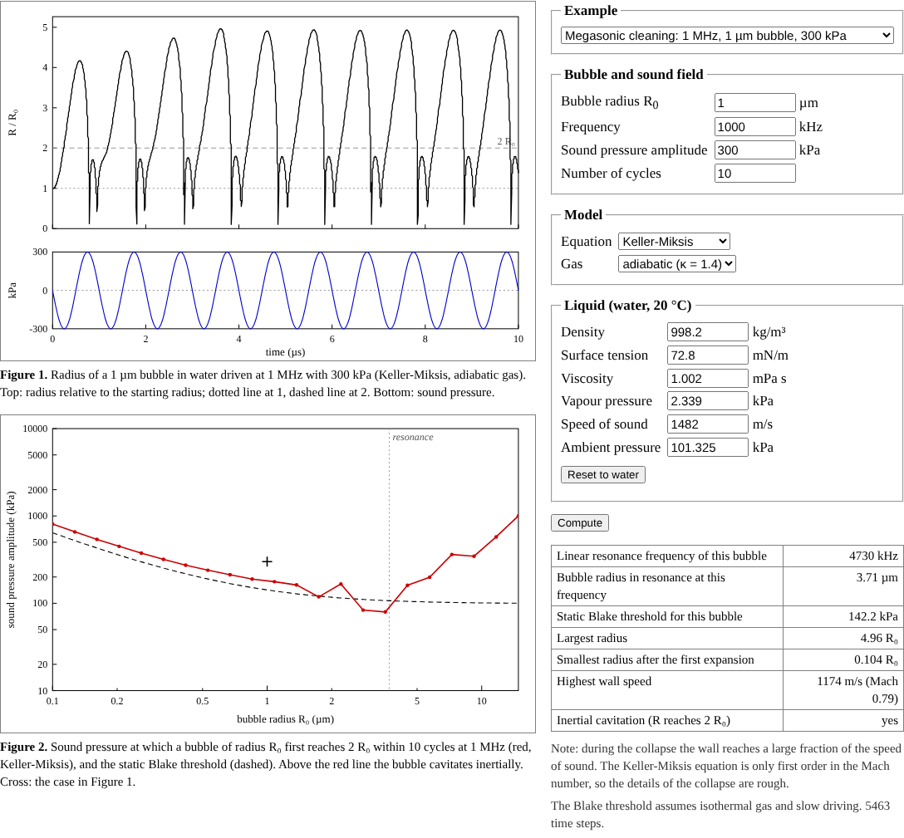

# Bubble dynamics

A single gas bubble in water driven by an ultrasonic or megasonic sound field, as in wafer
cleaning, computed with the Rayleigh-Plesset and Keller-Miksis equations, with the sound pressure at
which inertial cavitation starts. It is a single-page browser program with no server and no
libraries, plus a Python model with more physics.

**Open the program:** https://hashimishaque.com/bubble-dynamics/



## About the data

This is a theoretical simulation built from published equations. The checks compare it with known
analytical results. No measured data, and no data from any research centre, were used.

## What it does

- Solves the Keller-Miksis equation (the Rayleigh-Plesset equation with a correction for the
  compressibility of the liquid) with surface tension, viscosity, vapour pressure and a polytropic
  gas, using an adaptive Dormand-Prince Runge-Kutta method.
- The gas can be adiabatic, isothermal, or exchange heat with the liquid. The last option takes an
  effective polytropic exponent and a thermal damping from the linear theory of Prosperetti, Crum
  and Commander (1988), for the chosen bubble size and frequency.
- Shows the bubble radius and the sound pressure against time.
- Maps, for bubbles of different sizes, the sound pressure at which a bubble first grows to twice
  its starting radius (a common rule of thumb for inertial cavitation), next to the static Blake
  threshold.

## Checks

`node checks.js` runs the same checks as the page:

| Check | Expected | This program |
|---|---|---|
| Period of a small free oscillation divided by the linear-theory period | 1 | 1.000000 |
| Minnaert constant f₀R₀ for air in water without surface tension (m/s) | 3.286 | 3.286 |
| Collapse time of an empty cavity divided by Rayleigh's 0.915 R₀ (ρ/p₀)<sup>1/2</sup> | 1 | 1.00000 |
| Slow driving at 0.97 times the Blake threshold: largest radius | below 2.24 R₀ | 1.81 R₀ |
| Slow driving at 1.03 times the Blake threshold: largest radius | far beyond 2.24 R₀ | 31.4 R₀ |
| Keller-Miksis with c = 10⁹ m/s divided by Rayleigh-Plesset, largest radius | 1 | 1.000000 |

## Files

| File | Contents |
|---|---|
| `index.html` | The program, built from the files below |
| `bubble.js` | The equations and the integrator |
| `template.html` | The page around the code |
| `checks.js` | The checks, for Node.js 18 or newer |
| `build.py` | Puts the page together, with its title, description and preview tags: `python3 build.py` |
| `screenshot.png`, `social.png` | Screenshot for this README, and the preview image shown when the page is shared |
| `python/bubble_dynamics.py` | The Python model: thermal damping after Prosperetti, a Rosenbrock (Rodas4) integrator and regime maps |

## Python model

The Python model came first; the browser page is a simpler implementation of the same equations.
`python/bubble_dynamics.py` solves the Keller-Miksis equation with more physics than the page:
an effective polytropic exponent and thermal damping from Prosperetti's linear theory, a van der
Waals hard core for the gas, and an adaptive Rosenbrock integrator (Rodas4) with an analytic
Jacobian. It also draws regime maps over bubble size, frequency and pressure. It needs NumPy;
SciPy is used for cross-checks, Matplotlib for the figure, and Numba speeds up the maps.

```
python3 python/bubble_dynamics.py --simulate 2 40 150     # R0 = 2 µm, 40 kHz, 150 kPa
python3 python/bubble_dynamics.py --figure maps.png       # regime maps (slow without Numba)
```

At 40 kHz and 150 kPa a 2 µm bubble grows to 15.5 times its radius and collapses; at 1 MHz the
same bubble reaches only 1.87 times. Its result agrees with SciPy's Radau solver to about 10<sup>−7</sup>.

## Limitations

- One spherical bubble in an unbounded liquid; no jets near walls.
- Heat exchange only through linear theory, and no gas exchange with the liquid, so no rectified diffusion.
- The Keller-Miksis equation is first order in the Mach number of the wall.

## References

Lord Rayleigh, Phil. Mag. 34 (1917) 94; Minnaert, Phil. Mag. 16 (1933) 235; Plesset, J. Appl.
Mech. 16 (1949) 277; Blake (1949); Keller and Miksis, J. Acoust. Soc. Am. 68 (1980) 628;
Dormand and Prince, J. Comput. Appl. Math. 6 (1980) 19; Leighton, *The Acoustic Bubble* (1994);
Brennen, *Cavitation and Bubble Dynamics* (1995); Lauterborn and Kurz, Rep. Prog. Phys. 73
(2010) 106501.

## License

MIT, see `LICENSE`.
